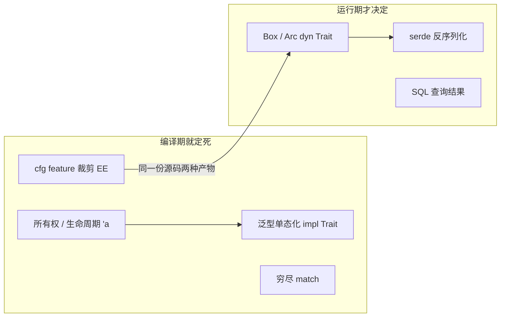

# 从 Tabby 的 Rust 代码学 Rust —— 新手向语言特性实战总结

> **基准**：`main` @ `f05db40e`，workspace 版本 `0.33.0-dev.0`，`edition = "2021"`
> **取材范围**：`crates/`（14 个开源 crate）+ `ee/`（4 个企业版 crate）；**排除** vendored 的 `crates/llama-cpp-server/llama.cpp` 子树
> **定位记法**：`文件` · `符号` `+N`（`+0` = 定义行，`+N` = 函数体内第 N 行）。行号随重构漂移，用 `docs/sourceReader/.progress/sr_tools.py offset FILE SYM` 实时取；文末「源码索引」给绝对行号方便一次性跳转
> **事实红线**：文中每段代码均从仓库逐字摘录、未改写；凡「未找到」的写法都明写未找到，不拿 Rust 通识冒充本仓库事实

---

## 0. 这篇回答什么

不讲 Rust 语法（交给 The Book），只回答三件事：

1. 一个 Rust 特性**在真实项目里长什么样**，不是 `fn main()` 玩具例子；
2. 这个项目**为什么这样选**——`dyn` 还是泛型、std 锁还是 tokio 锁、anyhow 还是 thiserror；
3. 新手**照抄会踩坑**的地方——本仓库自身就有不该照抄的写法，第 15 节逐条点出。

一句话总括本项目的 Rust 性格：**抽象全部压在 trait + enum 上，边界全部显式写出来（`Send + Sync`、`'a`、`Result<_, StatusCode>`），运行期能省则省，配置和数据库是唯一的「外部真相」。**

---

## 1. 三条主线：Rust 到底在约束你什么

| 约束 | 新手感受 | 本项目最集中的落点 |
|------|---------|------------------|
| **所有权 / 借用** | 「编译器不让我用这个变量」 | `stream!` 里的 `move` + 手工 clone 保命（§4、§6.3） |
| **零成本抽象** | 泛型单态化 vs trait object 的选择 | `impl Embedding` 对外、`Box<dyn Embedding>` 对内（§2.3） |
| **错误必须显式处理** | 满屏 `?` 和 `Result` | `anyhow` 一路 `?`，边界翻译成 `StatusCode`（§7） |



**新手最该建立的一个直觉**：Rust 里「动态」和「静态」是**两个不同的语法选择**，而不是性能微调。本项目对这个选择的判据非常清晰 —— **类型集合编译期已知 → 泛型/enum；类型集合由用户配置文件决定 → `dyn`**。这条判据贯穿 §2、§8。

---

## 2. trait：本项目的抽象脊柱

### 2.1 trait 定义：为什么要写 `: Sync + Send`

`crates/tabby-inference/src/completion.rs` · `trait CompletionStream` `+0`

```rust
#[async_trait]
pub trait CompletionStream: Sync + Send {
    /// Generate a completion in streaming mode
    async fn generate(&self, prompt: &str, options: CompletionOptions)
        -> BoxStream<'life0, String>;

    /// Generate a completion in non-streaming mode
    /// Returns the full completion as a single string
    async fn generate_sync(&self, prompt: &str, options: CompletionOptions) -> String {
        let mut stream = self.generate(prompt, options).await;
        let mut result = String::new();
        while let Some(chunk) = stream.next().await {
            result.push_str(&chunk);
        }
```

`ChatCompletionStream`（同目录 `chat.rs`）与 `Embedding`（`embedding.rs`）同构，都带 `: Sync + Send` 超约束。

**为什么必须写**：这三个 trait 在 §2.2 会被装进 `Arc<dyn ...>` 并放进 Axum 的共享 state。`Arc<T>` 要求 `T: Send + Sync` 才能跨线程用；把约束写在 trait 上，等于**把「实现者必须是线程安全的」这条契约放进类型系统**——漏写就不是「运行期偶尔炸」，而是根本编译不过。

**给新手的对应建议**：只要一个 trait 会被 `dyn` 化、会被多线程持有，就在 trait 声明上写 `Send + Sync`，别在调用点到处补 `where`。本项目 `ee/tabby-schema/src/schema/*.rs` 里几乎所有服务 trait（如 `ServiceLocator`、`AuthenticationService` `+0`）都写了这个边界，原因同上。

### 2.2 `async_trait` 与 `'life0`：宏在为对象安全擦屁股

同文件 `CompletionStream+0` 的返回类型写着 `BoxStream<'life0, String>`。`'life0` **不是你写的**，是 `async_trait` 宏展开后的产物：原生 `async fn` 在 trait 里返回一个匿名字典类型的 Future，那个 Future 不满足对象安全（dyn 需要已知大小的返回类型），所以宏把它改写成 `Pin<Box<dyn Stream + Send + 'life0>>` 形态。

症状识别法（新手排障用）：**看到 `'life0` / `'async` 这类生命周期，说明这个签名是宏展开的，改源码时要改宏输入而不是这个显示形态。**

### 2.3 同一份文件里 `dyn` 与泛型的取舍样本

`crates/http-api-bindings/src/completion/mod.rs` · `create` `+0`——**运行期擦型**：

```rust
pub async fn create(model: &HttpModelConfig) -> Arc<dyn CompletionStream> {
    let engine = match model.kind.as_str() {
        "llama.cpp/completion" => LlamaCppEngine::create(
            model
                .api_endpoint
                .as_deref()
                .expect("api_endpoint is required"),
            model.api_key.clone(),
        ),
        "ollama/completion" => ollama_api_bindings::create_completion(model).await,
        "mistral/completion" => MistralFIMEngine::create(
            model.api_endpoint.as_deref(),
            model.api_key.clone(),
            model.model_name.clone(),
        ),
        // ... 其余 kind 分支同构，见源文件
```

`model.kind` 是用户在 `config.toml` 里写的**字符串**，编译期无法知道有几家 → 只能 `dyn`。返回 `Arc`（不是 `Box`）是因为这个引擎实例会被多个请求处理任务共享。

`crates/http-api-bindings/src/rate_limit.rs` · `RateLimitedEmbedding` `+0` / `new_embedding` `+0`——**装饰器同时用两种分发**：

```rust
pub struct RateLimitedEmbedding {
    embedding: Box<dyn Embedding>,
    rate_limiter: RateLimiter,
}

pub fn new_embedding(embedding: Box<dyn Embedding>, request_per_minute: u64) -> impl Embedding {
    RateLimitedEmbedding {
        embedding,
        rate_limiter: new_rate_limiter(request_per_minute),
    }
}
```

这是全仓库最适合学「dyn vs 泛型」的一段：

- 字段里 `Box<dyn Embedding>`：被包装者由配置决定，异构、只有一个所有者 → `Box` + 动态分发；
- 函数返回 `impl Embedding`：装饰器类型是**这一个具体 struct**，编译期已知 → 静态分发，调用方零成本、还能继续 `#[derive]` 组合；
- 一句话记法：**「装谁」未知用 `dyn`，「我是谁」已知用 `impl`。**

### 2.4 trait 给默认方法当「骨架实现」

`CompletionStream::generate_sync`（§2.1 摘录，体内 `+3`）用 `generate` 拼出非流式实现。新手收益：实现者只需写最难的那个方法，其余从默认方法派生 —— 比在 8 个引擎里各抄一遍 `while let Some(chunk)` 收敛得多。

---

## 3. enum：不是常量集合，是带数据的代数类型

### 3.1 建模 + 穷尽匹配

`crates/tabby-common/src/config.rs` · `enum ModelConfig` `+0`

```rust
#[derive(Serialize, Deserialize, Debug, Clone)]
#[serde(rename_all = "snake_case")]
pub enum ModelConfig {
    Http(HttpModelConfig),
    Local(LocalModelConfig),
}
```

`crates/tabby/src/services/model/mod.rs` · `load_completion_and_chat`：两个变体各一条工厂路径，**没有 `_ =>` 兜底**——将来加第三种引擎时编译器会精确点名所有需要改的分歧点。这就是穷尽性的真实价值：**它把「加变体」的成本从「线上漏分支」转成「编译期红字」。**

### 3.2 enum 直接当 CLI 参数

`crates/tabby/src/main.rs` · `enum Device` `+0`

```rust
#[derive(clap::ValueEnum, strum::Display, PartialEq, Clone)]
pub enum Device {
    #[strum(serialize = "cpu")]
    Cpu,

    #[strum(serialize = "cuda")]
    Cuda,
```

`clap::ValueEnum` 让 `--device cuda` 的合法性校验、报错提示、`--help` 全部由 enum 派生。新手常写 `String` 再手工 `match` 校验，丢掉的是编译期保证。

### 3.3 serde 侧的一个诚实结论

- 本仓库**没有** `#[serde(tag = ...)]`（internally tagged）与 `#[serde(flatten)]` 用法，各 0 处；enum 一律 externally tagged + `rename_all`，`ModelConfig` 的「哪种后端」靠**外层字段名**（`http` / `local`）而非内部 tag 区分。
- 唯一相关的是 `ee/tabby-db/src/attachment.rs` · `enum AttachmentDoc` 用 `#[serde(untagged)]`：靠字段形状猜变体，为的是兼容旧库里已存的 JSON。
- **提醒**：`untagged` 牺牲了报错质量（解析失败只会说「没有匹配任何变体」）。新写的一律优先 externally tagged / `tag`，别学 `untagged`。

---

## 4. 所有权、借用与生命周期：什么时候必须写 `'a`

### 4.1 必须标注的真实场景：返回「借来的 guard」

`crates/tabby-inference/src/decoding.rs` · `get_trie` `+0`

```rust
    fn get_trie<'a>(&'a self, language: &'static Language) -> Option<CachedTrie<'a>> {
        let mut stop_words = language.get_stop_words();
        // append model stop words
        stop_words.extend(self.stop_words_from_model_config.iter().cloned());

        if stop_words.is_empty() {
            None
        } else {
            let hashkey = language.language().to_owned();
            let mut trie = self.stop_trie_cache.get(&hashkey);
```

配合同文件上方的类型别名 `type CachedTrie<'a> = dashmap::mapref::one::Ref<'a, String, Trie<u8>>;`。

为什么跑不掉：返回值 `Ref<'a, ...>` **是 DashMap 内部数据的一个借用句柄**，它的存活不能超过 `&self`。编译器推不出「这个 `'a` 来自 self」，因为返回类型里没有出现 `Self`。

新手判据（记这一条就够用）：**返回类型里出现引用、但函数签名里没有一个参数是引用 → 必须手写生命周期。**

### 4.2 借用语义当文档

`crates/tabby-common/src/axum.rs` · `closest_match` `+0`

```rust
fn closest_match<'a>(
    git_url: &str,
    repositories: impl IntoIterator<Item = &'a CodeRepository>,
) -> Option<&'a str> {
    let git_search = parse_git_url::GitUrl::parse(git_url).ok()?;

    repositories
        .into_iter()
        .filter(|elem| {
            parse_git_url::GitUrl::parse(&elem.git_url).is_ok_and(|x| x.name == git_search.name)
        })
        // If there're multiple matches, we pick the one with highest alphabetical order
        .min_by_key(|elem| elem.canonical_git_url())
        .map(|x| x.source_id.as_str())
}
```

三个可抄的点：

- `impl IntoIterator<Item = &'a CodeRepository>` 而不是 `&Vec<...>`：**接受任何可迭代容器**，且明确「借用的元素活多久」；
- `.ok()?`：`Option` 语境里 `?` 直接短路返回 `None`，省掉一层 `match`；
- `is_ok_and`（Rust 1.70+）替代 `map_or`：全仓库 `map_or` 出现 **0 次**，`is_ok_and` / `is_some_and` 是这里的既定风格。

### 4.3 `&str` 进、`String` 存

`crates/tabby-common/src/config.rs` · `ModelConfig::new_local` `+0`：参数收 `model_id: &str`，内部 `model_id.to_owned()` 存成 `String` 字段。**接收端尽量宽（`&str` 能同时吃 `String`/字面量），存储端必须拥有（`String`）**——这是本项目所有构造函数的一致写法。

### 4.4 `Cow`：只在需要「两种来源混用」时才出现

全仓库核心代码未使用 `Cow`。唯一一处是 `crates/sqlx-migrate-validate/src/validate.rs` · `Const/struct migrations`：`pub migrations: Cow<'static, [Migration]>`——迁移可以来自编译期静态数组，也可以来自运行期动态构造，`Cow` 让两种来源都不必复制。**新手结论：`Cow` 不是「省一点拷贝」的默认优化，而是「同一字段两种所有权来源」的解法。没有这个需求就别写。**

---

## 5. 智能指针与内部可变性：选哪一个的判据

| 需要的语义 | 本项目选 | 真实锚点 |
|-----------|---------|---------|
| 多处共享同一实例，且跨任务 | `Arc<T>` | `tantivy.rs` · `IndexReaderProvider+0` |
| 唯一所有者 + 异构装箱 | `Box<dyn Trait>` | `rate_limit.rs` · `RateLimitedEmbedding+0` |
| 跨 `.await` 的读写共享 | `Arc<tokio::sync::RwLock<Option<T>>>` | `tantivy.rs` · `IndexReaderProvider+0` |
| 同步、极短临界区的全局状态 | `Mutex` + `LazyLock` / `lazy_static!` | `oidc.rs` · `AUTH_REQS`；`path.rs` · `TABBY_ROOT` |
| 无锁分片读缓存 | `DashMap` | `decoding.rs` · `stop_trie_cache` |
| 全局可变但只整体替换 | `Mutex<Cell<PathBuf>>` | `path.rs` · `TABBY_ROOT+1` |

`crates/tabby/src/services/tantivy.rs` · `IndexReaderProvider` `+0`

```rust
pub struct IndexReaderProvider {
    provider: Arc<RwLock<Option<IndexReader>>>,
    loader: tokio::task::JoinHandle<()>,
}

impl IndexReaderProvider {
    pub fn reader(
        &self,
    ) -> impl futures::Future<Output = tokio::sync::RwLockReadGuard<'_, Option<IndexReader>>> {
        self.provider.read()
    }
```

四个信息量很大的细节：

1. `Arc<RwLock<Option<T>>>`：`Option` 表示「还没加载好」，`RwLock` 表示「后台会热替换」，`Arc` 表示「N 个 handler 共享」。**三层各解决一个不同问题，不是套娃习惯。**
2. `loader: JoinHandle<()>` 被存进 struct —— 任务句柄是**字段**，于是 §6.1 的 `Drop` 能 abort 它。
3. `reader()` 返回 `impl Future<Output = RwLockReadGuard<'_, ...>>`：把「借用会一路活到调用方用完」显式写进类型，这是把生命周期当 API 文档用。
4. `std::sync::Arc` 与 `tokio::sync::RwLock` **混搭**：`Arc` 管所有权共享（同步语义），`RwLock` 选 tokio 版因为读锁要跨 `.await`。见 §6.2。

`crates/tabby-common/src/path.rs` · `TABBY_ROOT` `+1`——为什么是 `Mutex<Cell<...>>` 这种看起来啰嗦的组合：

```rust
lazy_static! {
    static ref TABBY_ROOT: Mutex<Cell<PathBuf>> = {
        Mutex::new(Cell::new(match env::var("TABBY_ROOT") {
            Ok(x) => PathBuf::from(x),
            Err(_) => home::home_dir().unwrap().join(".tabby"),
        }))
    };
    static ref TABBY_MODEL_CACHE_ROOT: Option<PathBuf> =
        env::var("TABBY_MODEL_CACHE_ROOT").ok().map(PathBuf::from);
}
```

全局静态只能有**共享引用**（`&'static`），要改内容就必须内部可变 → 需要「只整体替换、不做部分修改」→ `Cell` 足够（比 `Mutex<T>` 的 `get_mut` 语义更窄）；而 `Cell` 本身不是 `Sync` → 外面套 `Mutex`。读函数 `tabby_root` 里是 `cell.get_mut().clone()`：**锁只保护那一瞬间的替换，出来就 clone 走值** —— 所以后面没有死锁面。

同文件 `set_tabby_root` 用 `#[cfg(any(feature = "testutils", test))]` 门住：测试能改全局 root，生产二进制里这个函数根本不存在。这是本仓库「用 feature 而非 pub 暴露测试钩子」的标准做法（§11.3 有对照）。

---

## 6. 异步与并发：本项目最密集的知识区

依赖事实：workspace 根 `Cargo.toml` 声明 `tokio = "1.28"`（`Cargo.lock` 实际解析到 1.42.0，**根上不写 features**，各 crate 自己追加：`tabby-common` = `full`、`llama-cpp-server` = `process`、`http-api-bindings` = `rt,macros`）；`futures = "0.3.30"`、`async-trait = "0.1.72"`、`axum = "0.8"`；入口是 `#[tokio::main]`（多线程 runtime）。

### 6.1 任务生命周期跟着对象走：`JoinHandle` 存字段 + `Drop` abort

`crates/tabby/src/services/tantivy.rs` · `IndexReaderProvider::default` `+4`（spawn 在体内 `+4`）与 `impl Drop for IndexReaderProvider`：

```rust
        let loader = tokio::spawn(async move {
            let doc = Self::load_async().await;
            *cloned_provider.write().await = Some(doc);
        });
```

```rust
impl Drop for IndexReaderProvider {
    fn drop(&mut self) {
        self.loader.abort()
    }
}
```

**为什么必须这样**：`tokio::spawn` 出来的任务被 runtime 接管，即使你 drop 了创建者它照样跑。把 `JoinHandle` 存成字段并在 `Drop` 里 `abort()`，等于手工实现「RAII 管任务」——这是 Rust 里最常被漏掉的一课：**异步任务不会随作用域结束而死。**

### 6.2 std 锁 vs tokio 锁：本项目的判据（两条都能抄）

**判据**：临界区是否跨越 `.await`。跨 → `tokio::sync` 锁；不跨（同步函数里、或几行就出锁）→ `std::sync` 锁 + `.unwrap()`。

std 锁 + 块作用域强制在 `.await` 前释放 —— `ee/tabby-webserver/src/oauth/oidc.rs` · `exchange_code_for_token` `+2`：

```rust
    async fn exchange_code_for_token(&self, code: String, state: Option<String>) -> Result<String> {
        let auth_req = {
            let mut auth_reqs = AUTH_REQS.lock().unwrap();
            match state {
```

那个 `{ ... }` 不是排版习惯：它让 `MutexGuard` 在块尾 drop，从而**在下一句 `.await` 之前释放**。因为 `std::sync::MutexGuard` 不是 `Future`，一旦持有它跨 `.await`，生成的 Future 就不再 `Send`，编译期直接报 `cannot be sent between threads safely`；就算换成 tokio 锁能编过，也会把并发度打成串行。**这是新手最容易撞的一类编译错误，本项目给出的解法是块作用域。**

跨 await 时先读后写的自死锁规避 —— `ee/tabby-db/src/cache.rs` · `get_or_refresh` `+9`：

```rust
        let value = self.value.read().await;
        if let Some(value) = &*value {
            Ok(value.clone())
        } else {
            drop(value);
            let mut value = self.value.write().await;
            let generated = refresh().await?;
            *value = Some(generated.clone());
            Ok(generated)
        }
```

`drop(value)` 那一行是**显式释放读锁**。少了它，`write().await` 会一边等没人持有的读锁、一边自己还持着读锁 → 永久挂住。注意 `&*value`（先解引用 `Option` 再判）和 `Ok(value.clone())`（返回副本、不把 guard 泄露出去）也是配套的两手。

`std::sync::Mutex` 的 `.unwrap()` 语义：PoisonError。本项目到处 `lock().unwrap()`，隐含判断是「**别的线程 panic 了，我也没兴趣继续**」。新手若来自 Java/Go，会本能地想处理这个 `Result`；在这个代码库里，`unwrap` 是**刻意的 fail-fast**，照抄可以，但要知道自己在赌什么。

### 6.3 channel 当「取消 / 结束」信号：`drop(tx)` 惯用法

`crates/tabby-index/src/indexer.rs` · `TantivyDocBuilder::build` 内的 `stream!` 块（`build` 在 `+0`，channel 建立约 `+17`，收尾约 `+47`）：

```rust
            let (tx, mut rx) = mpsc::channel(32);
...
            // drop tx to signal the end of the stream
            // the cloned is dropped in its own thread
            drop(tx);
...
            yield tokio::spawn(async move {
                let mut failed_count = 0;
                while (rx.recv().await).is_some() {
                    failed_count += 1;
                }
```

教科书级的三点：

1. 每个子任务 `tx.clone()`，**克隆体随自己所在任务结束而 drop**；
2. 原始 `tx` 在派发完任务后显式 `drop(tx)`；
3. 消费端 `while rx.recv().await.is_some()` —— `recv()` 返回 `None` 的唯一条件是「所有 Sender 都死了」，于是这个循环的终止**由所有权系统保证**，不需要哨兵值、不需要额外 flag。

这是 Rust 里最优雅的并发收敛模式之一，也是新手最少想到的（通常会去加 `Arc<AtomicBool>`）。本项目一致采用它：**未找到** `Option<Sender>` 式终止、未找到 `broadcast` / `watch` 通道。

同步世界 → 异步世界的桥 —— `crates/tabby-git/src/grep/mod.rs` · `grep` `+0`：

```rust
    let (tx, mut rx) = tokio::sync::mpsc::channel(1);

    let rev = rev.map(|s| s.to_owned());
    let query = query.clone();
    debug!("{:?}", query);
    let searcher = query.searcher()?;
    let task =
        tokio::task::spawn_blocking(move || grep_impl(repository, rev.as_deref(), searcher, tx));

    Ok(stream! {
        while let Some(file) = rx.recv().await {
            yield file;
        }

        if let Err(err) = task.await {
            warn!("Error grepping repository: {}", err);
        }
    })
```

`git2` 是同步阻塞库，直接在 async 任务里跑会占死 worker 线程 → 丢进 `spawn_blocking`。`tx` 被 `move` 进闭包（所有权转移，故外层不再持有），`channel(1)` 是刻意的背压：只缓冲 1 个文件。返回类型 `impl Stream<Item = GrepFile>` 把「这是个异步产出」写进签名。

顺带一个 `oneshot` 当取消信号的用法：`crates/tabby-git/src/commit.rs` · `stream_commits` `+3`（`let (stop_tx, stop_rx) = oneshot::channel();`），返回 `(BoxStream<...>, oneshot::Sender<()>)` —— 调用方**拿着「停止」这个动作本身作为值**；而同文件约 `+35` 处，往 tokio mpsc 发数据用的是 `tx_data.blocking_send(Ok(commit))` —— 因为代码此时跑在 `spawn_blocking` 的**同步闭包**里，没有 async 上下文可以 `.await`，tokio 为此专门提供 `blocking_send` / `blocking_recv`。新手在这类边界上常见的错误是直接 `send(...).await`，编译器会用「this method is async」相关的错提示你回到同步 API。

### 6.4 一边转发流、一边写库：`stream!` + `move` 的所有权编排

`ee/tabby-webserver/src/service/thread.rs` · `create_run`（`async_stream::stream!` 块在该函数体内约 `+55`）：

```rust
        // Copy ownership of db and thread_id for the stream
        let db = self.db.clone();
        let thread_id = thread_id.clone();
        let s = async_stream::stream! {
            if yield_thread_created {
                yield Ok(ThreadRunItem::ThreadCreated(thread::ThreadCreated { id: thread_id.clone()}));
            }
...
            for await item in s {
                match &item {
                    Ok(ThreadRunItem::ThreadAssistantMessageContentDelta(x)) => {
                        db.append_thread_message_content(assistant_message_id, &x.delta).await?;
                    }
```

那条注释就是这一节的全部教训：**`stream!` 是 `move` 语义**，块里用到的每个外部变量都要事先决定「谁拥有它」。`Arc` clone 一份、id clone 一份，然后才敢进块。新手在这里遇到的报错通常是 `use of moved value`，正解从来不是 `.clone()` 一把梭，而是先问「这个值原本该归谁」。

同一段还演示了流的**装饰而不消费**：`for await item in s { ...; yield item; }` —— 边落库边原样转发，错误用 `?` 直接终止流。

最外层 `crates/tabby/src/routes/chat.rs` · `chat_completions` `+0` 把流交给 Axum：

```rust
) -> Result<Sse<impl Stream<Item = Result<Event, anyhow::Error>>>, StatusCode> {
```

```rust
    Ok(Sse::new(s).keep_alive(KeepAlive::default()))
```

`Sse<impl Stream<...>>` 是「返回值类型匿名 + 元素是 Result」的组合，比 `Sse<BoxStream<...>>` 少一层装箱；`KeepAlive` 让长思考阶段不断流。

### 6.5 限并发：不引新依赖，用 `buffer_unordered(N)`

本项目**未找到** `tokio::sync::Semaphore`。并发上限统一由迭代器适配器控制：

- `crates/tabby-index/src/code/index.rs`：`.buffer_unordered(concurrency)`
- `crates/tabby-index/src/structured_doc/public.rs` · `sync`：`buffer_unordered(max(available_parallelism()*2, 32))`

```rust
            for await doc in s.buffer_unordered(std::cmp::max(std::thread::available_parallelism().unwrap().get() * 2, 32)) {
```

`buffer_unordered(N)` 的价值：**「同时最多 N 个在跑」由流的组合子保证**，不需要手写信号量、不需要 channel 计数。新手常犯的替代写法是 `for x in v { spawn(...) }`（无限并发把机器打满），这条是正解。

### 6.6 子进程守护与「没有优雅退出」这个事实

`crates/llama-cpp-server/src/supervisor.rs` · `LlamaCppSupervisor::new`（`kill_on_drop` 在 `tokio::process::Command` 链上）：

```rust
                    .kill_on_drop(true)
                    .stderr(Stdio::piped())
                    .stdout(Stdio::null());
```

stderr 被逐行读回、只保留最近 100 行（`VecDeque::with_capacity(100)` + `pop_front()`）用于报错回溯；退出码非 0 则 `sleep(1s)` 重启；重试 5 次且进程启动不足 60s 直接 `std::process::exit(1)`。`impl Drop for LlamaCppSupervisor`（体内 `+1`）就是 `self.handle.abort()`。

`kill_on_drop(true)` 是 Rust 子进程管理的关键开关：**默认情况下父任务被 abort 后子进程会变孤儿继续吃显存**；打开它，子进程的生命周期就绑在 `Child` 值上——又一个 RAII。

诚实结论：**本仓库没有 `CancellationToken`、没有 `tokio::signal`/`ctrl_c`、没有 Axum `with_graceful_shutdown`，也未找到 `catch_unwind`。**「优雅停机」在这份代码里是靠 `Drop` + `std::process::exit` 硬完成的，不是值得照抄的成熟面（见 §15）。

### 6.7 后台调度：`select!` 多路 + 空转兜底

`ee/tabby-webserver/src/service/background_job/mod.rs` · `start`：

```rust
    tokio::spawn(async move {
        loop {
            tokio::select! {
                job = db.get_next_job_to_execute() => {
                    let Some(job) = job else {
                        tokio::time::sleep(tokio::time::Duration::from_secs(5)).await;
                        continue;
                    };
                    if let Err(err) = db.update_job_started(job.id).await { ... continue; }
```

```rust
                else => { warn!("Background job channel closed"); break; }
```

`select!` 把「DB 轮询」和三条 cron 流（hourly / daily / ten_seconds，来自 `helper/cron.rs` 的 `CronStream`，其时区参数边界写作 `Tz: TimeZone + Send + Sync + 'static`）汇成一个循环；`else => break` 是所有分支都关闭时的兜底出口——**`select!` 若没有 `else`，全部关闭时会 busy-loop 空转烧 CPU**，这是新手看不出来的雷。

另外值得知道：这里的「单实例抢占」**不在 Rust 侧而在 SQL 侧**（`ee/tabby-db/src/job_runs.rs` · `get_next_job_to_execute` 取 `WHERE exit_code IS NULL AND started_at IS NULL ... LIMIT 1`，随后 `update_job_started` 打 `started_at`）。而且它是**读后写两步、没有事务 / `FOR UPDATE`**，属于乐观抢占 —— 多实例并发下会重复取到同一个 job。这条列进 §15。

---

## 7. 错误处理：anyhow 与 thiserror 的分工线

### 7.1 内部链路：`anyhow::Result` + `.context()` 一路 `?`

`crates/tabby-common/src/registry.rs` · `load_remote_registry`：

```rust
    let client = reqwest::Client::builder()
        .timeout(std::time::Duration::from_secs(5))
        .build()
        .context("Failed to build HTTP client")?;
    let model_info = client.get(format!("https://raw.githubusercontent.com/{registry}/registry-tabby/main/models.json"))
        .send().await.context("Failed to download")?
        .json().await.context("Failed to get JSON")?;
```

`.context(...)` 后紧跟 `?` 是这里的固定节奏：每跳一次贴一层人话，最外层拿到的是**一条可读的因果链**。统计事实（排除 vendored）：`.context(` 共 **37** 处，**`.with_context(` 为 0 次**（后者只在需要延迟构造字符串时才划算，本项目的 context 都是字面量）。`Option` 也能 `.context()` 转成 `Result`（`ee/tabby-webserver/src/service/license.rs`）。

### 7.2 边界类型：`thiserror` 派生 + `#[error(transparent)]` + anyhow 兜底变体

`crates/tabby-common/src/api/code.rs` · `enum CodeSearchError` `+0`

```rust
#[derive(Error, Debug)]
pub enum CodeSearchError {
    #[error("index not ready")]
    NotReady,

    #[error(transparent)]
    QueryParserError(#[from] tantivy::query::QueryParserError),

    #[error(transparent)]
    TantivyError(#[from] tantivy::TantivyError),

    #[error(transparent)]
    Other(#[from] anyhow::Error),
}
```

这段是「什么时候用哪个」的最佳答案：

- 调用方**需要 match 出不同行为**（`NotReady` 要重试、其他要报错）→ 必须是 enum，于是 `thiserror` 派生；
- `#[error(transparent)]` + `#[from]` = 包装第三方错误但不加噪音、`?` 自动转换；
- **最后一个变体 `Other(#[from] anyhow::Error)` 让两套体系共存**：类型化边界照样能吃下任意过程错误，不必为每个新依赖加变体。

依赖分布：15 份 `Cargo.toml` 声明 `anyhow`（workspace 根 + 14 个 crate），只有 6 份声明 `thiserror`（根 + `tabby-common`、`tabby`、`sqlx-migrate-validate`、`tabby-webserver`、`tabby-schema`）—— 这个比例本身就是分工。`ee/tabby-schema/src/schema/mod.rs` · `enum CoreError` 是 GraphQL 侧的类型化边界（带 payload + `#[from] ValidationErrors` + `#[from] anyhow::Error`）。

### 7.3 错误 → HTTP：本项目没做「错误类型自带响应」

反直觉的一条：全仓库 `IntoResponse` 出现 8 次、分布在 4 个文件且**全部在 `ee/` 侧**（`routes/mod.rs`、`routes/ui.rs`、`routes/hub.rs`、`service/mod.rs`），开源 `crates/` 侧 **0 次**；而且**没有一处是给错误类型实现的**——那 8 处都是 `-> impl IntoResponse` 的 handler 返回类型或 import（`ui.rs` 的 `WebStaticFile` 是为静态文件服务的）。真实做法是 handler 签名直接返回 `StatusCode`：

`crates/tabby/src/routes/completions.rs` · `completions` `+0`

```rust
#[instrument(skip(state, request))]
pub async fn completions(
    State(state): State<Arc<CompletionService>>,
    Extension(allowed_code_repository): Extension<AllowedCodeRepository>,
    TypedHeader(MaybeUser(user)): TypedHeader<MaybeUser>,
    user_agent: Option<TypedHeader<headers::UserAgent>>,
    Json(mut request): Json<CompletionRequest>,
) -> Result<Json<CompletionResponse>, StatusCode> {
    if let Some(user) = user {
        request.user.replace(user);
    }

    let user_agent = user_agent.map(|x| x.0.to_string());

    match state
        .generate(&request, &allowed_code_repository, user_agent.as_deref())
        .await
    {
        Ok(resp) => Ok(Json(resp)),
        Err(err) => {
            warn!("{}", err);
            Err(StatusCode::BAD_REQUEST)
        }
    }
}
```

代价写在最后一行：**anyhow 的整条因果链只进日志，客户端只拿到 400**。好处是不泄漏内部错误文本。GraphQL 侧才有类型化映射：`impl<S: ScalarValue> IntoFieldError<S> for CoreError` 把变体翻成 `{"code": "FORBIDDEN"}` 之类的扩展字段，供前端分支处理。

新手可抄的结论：**内部一律 anyhow，跨界才类型化；对外要分支处理的接口走 GraphQL/`IntoFieldError`，纯 REST 就 `Result<Json<_>, StatusCode>` + 日志留全链。**

### 7.4 启动路径不是 `fn main() -> Result`，而是自研 `fatal!`

`crates/tabby/src/main.rs` · `macro_rules! fatal` `+0`

```rust
#[macro_export]
macro_rules! fatal {
    ($msg:expr) => {
        ({
            tracing::error!($msg);
            std::process::exit(1);
        })
    };

    ($fmt:expr, $($arg:tt)*) => {
        ({
            tracing::error!($fmt, $($arg)*);
            std::process::exit(1);
        })
    };
}
```

消费点在 `crates/tabby/src/routes/mod.rs`：`.unwrap_or_else(|err| fatal!("Error happens during serving: {}", err))`。

为什么不用 `main() -> anyhow::Result<()>`：那样退出码是 1 但**错误文本走 `Debug` 打印、不进 tracing、不进容器日志的结构化通道**。一个服务进程宁可自己控制「记日志 + 定退出码」。而 CLI 工具（`crates/tabby-index-cli/src/main.rs`）就是正统的 `fn main() -> anyhow::Result<()>`。**这两者的区别，就是库/服务与工具的区别。**

### 7.5 `let-else`：本仓库大量使用（≥30 处）

`ee/tabby-webserver/src/routes/mod.rs` · `require_login_middleware` 连着三条。示例见 §6.7 的 `let Some(job) = job else { ... continue; }`。

这个语法对新手是纯收益：**「解绑失败就退出当前控制流」写成一等结构**，避免了 `match` 缩进地狱，也让「此处不可能没有值」的意图显眼。本项目风格：`let-else` 用于「拿不到就直接 return/continue」，`if let` 用于「有就顺便做点什么」。

组合子偏好（逐个查证过的）：`.ok_or_else`（`config.rs` · `config_id_to_index`）、`.unwrap_or_default`（`axum.rs` · `AllowedCodeRepository::new_from_config`）、`.is_ok_and` / `.is_some_and`；`map_or` **0 次**。

---

## 8. serde 与「配置文件是唯一真相」

`crates/tabby-common/src/config.rs` · `Config::load` `+0`（节选，`save` 在 `+50`）：

```rust
    #[cfg(feature = "testutils")]
    pub fn save(&self) {
        serdeconv::to_toml_file(self, crate::path::config_file().as_path())
            .expect("Failed to write config file");
    }

    fn validate_dirs(&self) -> Result<()> {
        let mut dirs = HashSet::new();
        for repo in self.repositories.iter() {
            let dir = repo.dir().display().to_string();
            if !dirs.insert(dir.clone()) {
                return Err(anyhow!("Duplicate directory in `repositories`: {}", dir));
            }
        }
        Ok(())
    }
```

`load` 里的容错策略值得单独学（体内约 `+25` 起）：

```rust
        if let Err(e) = cfg.validate_config() {
            InfoMessage::new(
                "Parsing config failed",
                HeaderFormat::BoldRed,
                &[
                    &format!(
                        "Warning: Could not parse the Tabby configuration at {}",
                        crate::path::config_file().as_path().to_string_lossy()
                    ),
                    &format!("Reason: {e}"),
                    "Falling back to default config, please resolve the errors and restart Tabby",
                ],
            )
            .print();
            process::exit(1);
        }
```

三条设计判断，新手可以直接内化成规则：

1. **`#[derive(Default)]` + 每个字段 `#[serde(default)]`** ⇒ 「文件不存在 / 空文件」等价于「默认配置」，`load` 首行就是 `if !cfg_path.exists() { return Ok(Default::default()) }`。这是让一个可选配置文件永不炸的最省写法。
2. **校验分两级、后果不同**：`validate_dirs`（目录重名）→ 打印警告 + **回退默认配置继续跑**；`validate_config`（模型配置不自洽）→ 打印 + `process::exit(1)`。区分「能降级」和「不能带着跑」。
3. **`save` 被 `#[cfg(feature = "testutils")]` 门住**：生产二进制里写配置的能力根本不存在（配置由人写、不由程序写），只有测试能落盘。**用 feature 而不是「别调用它」的注释来收缩 API 面**，是 Rust 里唯一能被编译器执行的纪律。

另外，读取方**每次现读**（`Config::load()` 调用点分散在 `main.rs`、`axum.rs`、`service/repository/mod.rs`、`background_job/git.rs`），没有全局缓存 —— 换来「改文件即生效」，代价是热路径重复解析 TOML。注意这与 §5 的 `Cache<T>` 并不矛盾：缓存的是 DB 侧配置，不是 `config.toml`。

serde 属性使用普查（都查证过）：`#[serde(default)]` 有（`config.rs` 的 `Config` 每字段都标）；`#[serde(skip_serializing_if = "Option::is_none")]` **恰好 30 处**（最密集 `crates/tabby-common/src/api/event.rs`，`Vec::is_empty` 变体在 `crates/tabby/src/services/health.rs`）；`rename_all` **11 处 = 10 处 serde + 1 处 `#[sqlx(rename_all = "lowercase")]`**（`ee/tabby-db/src/ingestion.rs`），风格一共五种：`lowercase` / `snake_case` / `camelCase` / `PascalCase` / `UPPERCASE`，各自对齐不同外部契约（`api/event.rs` snake_case、`usage.rs` camelCase、`schema/license.rs` UPPERCASE、`service/email/testutils.rs` PascalCase、`schema/auth.rs` lowercase）——**不是失控，但新加字段前要先确认对齐哪个外部消费者**。`tag` / `flatten` 均为 0。

`api/event.rs` · `enum Event` 是 enum + serde 的组合样本（关联数据 + 逐字段 `skip_serializing_if`）：

```rust
#[derive(Serialize, Deserialize, Debug, Clone)]
#[serde(rename_all = "snake_case")]
pub enum Event {
    View { completion_id: String, choice_index: u32,
        #[serde(skip_serializing_if = "Option::is_none")] view_id: Option<String> },
```

---

## 9. newtype：把「一个字符串」升级成「一个概念」

`crates/tabby-index/src/code/intelligence/id.rs` · `impl TryFrom<&Path> for SourceFileId` `+0`

```rust
impl TryFrom<&Path> for SourceFileId {
    type Error = anyhow::Error;

    fn try_from(path: &Path) -> Result<Self> {
        if !path.is_file() {
            bail!("Path is not a file");
        }

        let git_hash = get_git_hash(path)?;
```

同文件还有 `FromStr` / `ToString`。要点：

- **可失败的构造进类型系统**：`TryFrom` 而非「构造函数 + 祈祷」。拿到 `SourceFileId` 就等于拿到了「它指向一个真实文件、且有 git hash」这个前提，后续代码不用再判空。
- 类型是 `&Path` 而不是 `String`：把「路径」和「路径的字符串形式」分开，避免 `PathBuf::from` 散落各处。
- `type Error = anyhow::Error`：newtype 的构造错误不必类型化（调用方只会 `?` 上抛），这也是 anyhow/thiserror 分工的一条应用。

其他手写 impl 样本：`crates/hash-ids/src/lib.rs` 手写 `Display`（`match` 每个变体给文案）+ `impl std::error::Error`；`ee/tabby-schema/src/dao.rs` 给**外部类型** `juniper::ID` 补 `AsRowid` / `AsID` extension trait —— Rust 里这叫孤儿规则的正经绕法：**想给别人的类型加方法，在自己的 crate 里定义一个 trait 并实现它**，而不是改上游。

反例也有价值：`TagsConfigurationSync(pub TagsConfiguration)` 故意只暴露 `.0`、**没有** `impl Deref`。新手常条件反射地给 newtype 加 `Deref` 图省事，本项目（在 §14 那个 unsafe 的同一文件）选择让它不可假装成内层类型 —— 一旦 `Deref` 出去，那层「我确认过它线程安全」的语义就散了。

---

## 10. 宏的三个层次：从 derive 到自己造 DSL

本项目三种宏都在用，正好当教学梯度：

### 10.1 derive 宏（最常用，占绝大多数）

`#[derive(Serialize, Deserialize)]`、`#[async_trait]`、`#[derive(FromRow)]`（`ee/tabby-db` 里 20+ 个 DAO）、`#[derive(GraphQLObject)]`（`ee/tabby-schema/src/schema/thread/types.rs` 约 20 处）、`#[derive(Parser)]` / `#[derive(Subcommand)]`（clap）、`#[derive(Error)]`（thiserror）、`#[derive(OpenApi)]`（utoipa）。

**新手认知点**：这些「属性」不是装饰，是**代码生成器**。看懂 Rust 项目的关键是认出哪个 derive 生成了什么（`FromRow` 生成 `sqlx::FromRow` impl，字段名 ↔ 列名靠 serde 风格属性映射）。因此**改字段名会同时改序列化结果**，这是本项目最常见的隐性联动。

### 10.2 声明宏 `macro_rules!`：为可读性造小 DSL

`crates/tabby/src/main.rs` · `fatal!`（§7.4，`#[macro_export]` 让跨 crate 可用），`crates/tabby/tests/goldentests.rs` · `assert_golden!` `+0`：

```rust
macro_rules! assert_golden {
    ($expr:expr) => {
        insta::assert_yaml_snapshot!(golden_test($expr).await, {
            ".id" => "test-id"
        });
    }
}
```

它把「起真实二进制打 HTTP + 快照 + 脱敏固定字段」压成一行。同理 `crates/tabby-common/src/axum.rs` 测试模块内的 `assert_match_first!`。**判据**：重复 3 次以上、且每次只是替换一个表达式 → 用 `macro_rules!`；需要跨 crate 导出 → `#[macro_export]`。不要为了 DRY 造宏，那是函数的事。

### 10.3 过程宏：本仓库唯一一个，且理由很硬

`ee/tabby-db-macros/src/lib.rs` 暴露函数式宏 `#[proc_macro] query_paged_as`。它用 `syn` 手写 `Parse`（一个内部小 DSL：`"created_at" as "created_at!"` 表示「这列非空且要改名」），再用 `quote` 生成代码：

```rust
    quote! {
        sqlx::query_as(&crate::make_pagination_query_with_condition({
            let _ = sqlx::query_as!(#typ, "SELECT " + #columns + " FROM (SELECT * FROM " + #table_name + ")");
            &#table_name
        }, &[ #(#column_args),* ], #limit, #skip_id, #backwards, #condition))
    }
    .into()
```

为什么值得写一个 proc-macro：sqlx 的 `query_as!` 是**编译期查库校验**的宏，但游标分页的**列集合与条件是动态拼接的**，`query_as!` 吃不了。这段生成体的巧妙处在 `let _ = sqlx::query_as!(...)`：**它只是让编译器去「验证一遍这个类型和这段 SQL 匹配」，产物丢掉不用**；真正执行的是外面那个运行期 `sqlx::query_as(&str)`。于是同时拿到「编译期类型校验」和「运行期动态 SQL」。

使用点：`ee/tabby-db/src/repositories.rs` · `list_repositories_with_filter`。

**给新手的门槛判据**：proc-macro 是「语言扩展」，本仓库 18 个 crate 里只允许了 1 个，且它解决的问题（动态 SQL + 编译期校验）用函数做不到。**先确认函数和 `macro_rules!` 都不够，再碰 `syn`/`quote`。**

---

## 11. workspace 与 feature：一套源码怎么编出开源版和企业版

### 11.1 集中版本，但不在 workspace 里开 features

根 `Cargo.toml`：`[workspace] resolver = "1"`，**18 个 members**（14 个 `crates/*` + 4 个 `ee/*`；`ee/tabby-ui` 是前端、不在 Rust workspace 内）；`[workspace.package]` 统一 `version/edition/authors/homepage`；`[workspace.dependencies]` 统一第三方版本，**包括 git pin**（tantivy `rev = "4143d31"`；sqlx 用 fork `wsxiaoys/sqlx` `rev = "77eb94d"`，且**上方附了两条 issue 链接注释说明为什么必须 fork**）。子 crate 一律 `xxx.workspace = true` + 局部追加 `features`。

这就是 §6 里「tokio 根上不写 features」的原因，也是 Rust 新手最容易写错的一处：**workspace 依赖是版本与来源的单一真相，特性开关属于各 crate 自己**（否则一个 crate 的 feature 会被强加给全workspace）。

内部 crate 两种引用并存：① 也进 `[workspace.dependencies]` 的（`hash-ids = { path = "./crates/hash-ids" }`，下游 `hash-ids.workspace = true`）；② 直接路径依赖（`tabby-common = { path = "../tabby-common" }`、`tabby-db = { path = "../../ee/tabby-db" }`）。测试期开特性写在依赖声明里：`tabby-common = { path = "../tabby-common", features = ["testutils"] }`。

### 11.2 feature 做企业版裁剪

`crates/tabby/Cargo.toml` · `[features]`：

```toml
[features]
default = ["ee", "llama-cpp-server/binary"]
ee = ["dep:tabby-webserver"]
cuda = ["llama-cpp-server/cuda"]
static-ssl = ['openssl/vendored']
prod = ["ee", 'tabby-webserver/prod']
```

配合 `tabby-webserver = { path = "../../ee/tabby-webserver", optional = true }`。

三个可抄的点：

- **`dep:tabby-webserver` 语法**：把「这个可选依赖本身」变成 feature，避免 feature 名与依赖名同名带来的隐式歧义。
- **依赖方向**：开源 bin crate `crates/tabby` **依赖** ee，ee **从不依赖** `crates/tabby`（`ee/tabby-webserver` 反向 path 依赖 `tabby-common`/`tabby-index`/`tabby-inference`）。所以「企业版代码看不到开源二进制内部」，只能通过公共 trait 交接 —— 这是这个仓库能保持 MIT 目录干净的结构原因。
- **裁剪点写在装配层**：`crates/tabby/src/serve.rs` 里 `#[cfg(feature = "ee")]` 共 8 处（导入、`ServeArgs.no_webserver` 字段、构造、路由挂载……），并有对称兜底 `#[cfg(not(feature = "ee"))] routers.push(server_setting_router);`。**注意这条纪律：cfg 集中在 main/装配层，业务模块里不散布 feature 判断。** 反面后果是同一函数在两种 feature 下走不同代码路径，散多了就没人能测全。

### 11.3 用 `public` mod 收窄 API 面

`ee/tabby-webserver/src/lib.rs` 里 `pub mod public { pub use super::{...::Webserver}; }` —— 开源侧只 `use tabby_webserver::public::Webserver`。配合 §8 的 `#[cfg(feature = "testutils")]`，是同一个思想的两个方向：**能用可见性/feature 让编译器管的事，不要交给 code review。**

---

## 12. 测试：本项目的三层写法

1. **单元测试**：文件尾 `#[cfg(test)] mod tests`（Rust 惯例，同文件同模块，因此可测私有函数）。异步测试用 `#[tokio::test]`，DB 测试用真库而不是 mock（`ee/tabby-db` 的 `DbConn::new_in_memory()`）。范例 `ee/tabby-db/src/repositories.rs` · `test_update_repository`（arrange-act-assert 三段带注释）。
2. **迁移测试**：`ee/tabby-db/src/migration_tests.rs` 逐条重放 `migrations/`（49 组 up/down）验证升级不丢数据；`crates/sqlx-migrate-validate` 给 sqlx 的 `Migrator` 实现 `Validate`，比对 `_sqlx_migrations` 里已应用版本与 checksum，不匹配返回 `ValidateError::VersionNotApplied`，`DbConn::backup_db` 据此决定要不要先备份 sqlite 文件。**这是「把数据库升级当成可测试对象」的写法，比多数项目认真。**
3. **金标（golden）测试**：`crates/tabby/tests/goldentests.rs` + `goldentests_chat.rs` 起**真实二进制**打 `/v1/completions`，用 `insta` 快照（dev-dependency 开 `features = ["yaml", "redactions"]`），`assert_golden!`（§10.2）里 `".id" => "test-id"` 就是把随机字段脱敏。快照落 `crates/tabby/tests/snapshots/goldentests__run_golden_tests.snap`（`<文件>__<测试函数>.snap` 命名；`-2` 后缀是同一测试的第二次调用）。门控写法：

```rust
#[cfg(all(target_os = "macos", target_arch = "aarch64"))]
#[tokio::test]
#[serial]
async fn run_golden_tests() {
    wait_for_server(Some("metal")).await;
```

`#[serial]` 来自 `serial_test`（根 `Cargo.toml:62` 声明为 `serial_test = { version = "3.0.0", features = ["file_locks"] }`）—— 因为两个测试会抢同一个端口和索引目录，必须串行跑。平台门 + 串行 + 真实推理，这三件事合起来说明：**这类测试测的是「模型输出是否变了」，成本极高，所以钉在一种硬件上。** 新手别把它当范式，但要知道快照测试必须解决「不确定性」，`redactions` 就是那把钥匙（`insta` 在 `[dev-dependencies]` 里开 `features = ["yaml", "redactions"]`）。

其他测试依赖：`assert_matches`、`temp_testdir`、`serde-jsonlines`、`assert-json-diff`、`tracing-test`。**`rstest` / `test-case` / `proptest` 全都没有**（对 `Cargo.toml` 全量 grep 为空），参数化靠手写数组 `for` 循环（`config.rs` 测试模块）或 `macro_rules!`。

一个纯风格样本：`crates/tabby-common/src/config.rs` 的测试直接用 `r#"..."#` 内嵌 TOML 喂 `serdeconv::from_toml_str` —— 测序列化时**用真实配置文件形态而不是构造 struct**，才测得到 `#[serde(default)]` 这些属性。

---

## 13. RAII 贯穿到可观测性

`crates/tabby/src/otel.rs` · `impl Drop for OtelGuard`：

```rust
impl Drop for OtelGuard {
    fn drop(&mut self) {
        if let Some(tracer_provider) = self.tracer_provider.take() {
            if let Err(err) = tracer_provider.shutdown() {
```

`init_tracing_subscriber` 按 `Option<String>` 的 otlp endpoint 条件性 push `OpenTelemetryLayer` 到 `Vec<Box<dyn Layer<Registry> + Send + Sync>>`，再叠 fmt layer 与 `EnvFilter`；默认日志级别随 `cfg!(feature = "prod")` 在 info/debug 间切；返回 `OtelGuard`，`main` 里写 `let _guard = ...`。

这是 Rust 里「必须收尾的东西」的标准解法：**给收尾动作做一个类型，靠作用域结束自动执行**，不需要 `try/finally`。同类还有 §6.1 的 `JoinHandle`、§6.6 的 `kill_on_drop`。三个放一起讲，新手才会真正理解 RAII 是「资源=值，释放=drop」而不是一个语法糖。

日志侧的宏用法固定：`#[instrument]` 只 6 处、全在 HTTP 入口，且一律 `skip` 掉不可 `Debug` 的参数（`#[instrument(skip(state, request))]`）；其余直接 `info!/debug!/warn!/error!`。后台任务用 `logkit::info!` 加时间戳前缀（`background_job/index_commits.rs`）。

---

## 14. 全仓库唯一的 `unsafe`：一处，且理由写得很清楚

`crates/tabby-index/src/code/languages.rs` · `TagsConfigurationSync` `+1`

```rust
// Mark TagsConfiguration as thread sync / safe.
pub(crate) struct TagsConfigurationSync(pub TagsConfiguration);
unsafe impl Send for TagsConfigurationSync {}
unsafe impl Sync for TagsConfigurationSync {}
```

背景：tree-sitter 的 `TagsConfiguration` 上游没有声明自己是 `Send/Sync`（它内部持 `UnsafeCell` 之类的东西），但本项目**只读使用**它，作者据此手工补上标记。

这一处之所以值得写进新手教程，是因为它示范了 `unsafe` 的**正确形态**：

1. 新建一个 newtype 包住别人不安全/未标注的类型（不改上游、不污染全局）；
2. `unsafe impl` 的**理由写在紧邻注释里**（"Mark ... as thread sync / safe"），并且只有 `pub(crate)` 可见；
3. 想用它就必须穿 `.0`，因此「我在用那个被担保过的类型」在代码里显眼（§9 提到这里刻意不 impl `Deref`）。

**新手该带走的原则**：`unsafe` 不是「跳过借用检查的技巧」，而是「向编译器提交一份人类保证书」。写之前要能回答：**我凭什么保证这个不变量成立？** 答不出就别写。本仓库 18 个 crate、上万行代码只有这一处，可以当作量级参照。

---

## 15. 值得学 / 不该照抄：本仓库的诚实清单

| # | 观察 | 性质 | 锚点 |
|---|------|------|------|
| 1 | **没有优雅停机**：无 `CancellationToken`、无 `tokio::signal`、无 `with_graceful_shutdown`，停止靠 `Drop::abort()` + `std::process::exit(1)` | 风险 | `supervisor.rs` · `Drop`；`main.rs` |
| 2 | 后台任务单例抢占靠 SQL 的「读后写」两步，无事务 / `FOR UPDATE` ⇒ 多实例可能重复执行同一 job | 风险 | `ee/tabby-db/src/job_runs.rs` · `get_next_job_to_execute` |
| 3 | `spawn_blocking(|| async { ... })` 双重 await 的可疑写法（阻塞线程里再造异步） | 瑕疵 | `ee/tabby-webserver/src/service/analytic.rs` · `dir_size` |
| 4 | `.expect("api_endpoint is required")` 在工厂函数里：配置校验（§8 `validate_config`）确实先挡住了，但把「配置不合法」的失败方式换成 panic | 依赖前置校验 | `http-api-bindings/src/completion/mod.rs` · `create+7` |
| 5 | `.unwrap()` 共 **1014** 处：**788 在 `#[cfg(test)]` 标记之后**（同文件内）、226 在其余位置，生产侧集中在启动/构造期（`Router::into_make_service`、`home_dir().unwrap()`）——即「一次性失败就整体退出」的位置 | 分布合理，别推广到热路径 | 全仓统计（排除 vendored） |
| 6 | `unimplemented!()` / `todo!()` 在生产路径：`chat.rs` · `chat_completions_utoipa`（只为 utoipa 生成 OpenAPI 签名的占位 handler，`#[allow(unused)]` 门着）、`axum.rs` · `MaybeUser::encode` | 设计特性 | 两文件 |
| 7 | `edition = "2021"` 且 `resolver = "1"`（未升 2）；**没有任何 crate 级 `#![allow/deny]`，也没有 `[lints]` 段**，放行只以约 20+ 处条目级 `#[allow(dead_code)]` / `#[allow(unused)]` 出现 | 待收敛 | 根 `Cargo.toml`；`oauth/github.rs` |

`#[allow(dead_code)]` 集中出现在 `ee/tabby-webserver/src/oauth/{github,gitlab,google}.rs` 与 `routes/oauth.rs`：那类结构体字段**只用于 serde 反序列化，代码里从不读**——Rust 没有「注解消费字段」的概念，编译器判它死代码，所以必须显式放行。**新手第一次写 serde 结构体一定会撞这个 warning，这是正解之一（另一解是 `#[serde(dead_code)]` 风格地把它转成真的读取）。**

---

## 16. 给新手的 15 条可执行建议（每条都有本仓库锚点）

**先编译期，后运行期**
1. 类型集合编译期已知 → enum + 穷尽 `match`，别加 `_ =>`（`config.rs` · `ModelConfig`）。
2. 类型由用户配置/外部输入决定 → `Arc<dyn Trait>` 工厂（`crates/http-api-bindings/src/completion/mod.rs` · `create`）。
3. 会被 `dyn` + 多线程持有的 trait，声明上就写 `: Sync + Send`（`tabby-inference` 三个 trait）。
4. 装饰器/包装层返回 `impl Trait`，内部字段才用 `Box<dyn Trait>`（`rate_limit.rs`）。

**所有权**
5. 返回类型里有引用而参数里没有 → 必须标 `'a`（`decoding.rs` · `get_trie`）。
6. 进参数用 `&str`/`&Path`，进字段用 `String`/`PathBuf`（`config.rs` · `new_local`）。
7. 接受容器写 `impl IntoIterator<Item = &T>`，别写 `&Vec<T>`（`axum.rs` · `closest_match`）。
8. `Cow` 只在「同一字段两种所有权来源」时用，不是拷贝优化（`sqlx-migrate-validate/src/validate.rs`）。

**并发**
9. `tokio::spawn` 的句柄要么立即 await，要么**存字段并在 `Drop` 里 abort**（`tantivy.rs`）。
10. 结束一个多生产者 channel，靠 `drop(tx)` + `while recv().await.is_some()`，不要加 `AtomicBool`（`indexer.rs`）。
11. 同步阻塞库（`git2`）丢 `spawn_blocking`，结果用 mpsc 桥回异步；在阻塞线程里发 tokio channel 用 `blocking_send`（`grep/mod.rs`、`commit.rs`）。
12. 临界区跨 `.await` → `tokio::sync` 锁；不跨 → `std::sync` 锁并用 `{ }` 块或显式 `drop(guard)` 提前释放（`oidc.rs`、`cache.rs`）。
13. 限并发用 `buffer_unordered(N)`，别自己造信号量（`code/index.rs`、`structured_doc/public.rs`）。

**错误与配置**
14. 内部 `anyhow` + `.context("...")?`；对外需要分支才 `thiserror` 建 enum，并在最后留一个 `Other(#[from] anyhow::Error)` 兜底变体（`api/code.rs` · `CodeSearchError`）。
15. 可选配置文件：`Default` derive + 每字段 `#[serde(default)]`，校验分「可降级警告」和「必须退出」两级，写能力用 `#[cfg(feature = "testutils")]` 门住（`config.rs` · `Config::load`）。

**结构**
- 第三方类型的 `FromRow`/`GraphQLObject`/`serde` 三个方向的字段名是**同一份事实的三次投影**，改一个字段名要同时跑一遍 TOML 测试、GraphQL codegen、DB 迁移测试。
- 需要「收尾」的一律造一个类型靠 `Drop` 管（`OtelGuard` / `IndexReaderProvider` / `kill_on_drop`），不用 finally。
- `unsafe` 只允许「newtype 包住 + 理由写注释 + `pub(crate)` 可见」这一种形态。

---

## 17. 源码索引（绝对行号，取用于 `f05db40e`，仅供一次性跳转）

| 主题 | 文件:行 | 符号 |
|------|---------|------|
| trait + Send/Sync + async_trait | `crates/tabby-inference/src/completion.rs:17,18` | `#[async_trait]` / `trait CompletionStream` |
| dyn 工厂 | `crates/http-api-bindings/src/completion/mod.rs:14` | `create` |
| dyn/泛型混合装饰器 | `crates/http-api-bindings/src/rate_limit.rs:23,28` | `RateLimitedEmbedding` / `new_embedding` |
| enum 建模 | `crates/tabby-common/src/config.rs:278` | `enum ModelConfig` |
| 穷尽 match | `crates/tabby/src/services/model/mod.rs:30` | `load_completion_and_chat` |
| enum 当 CLI | `crates/tabby/src/main.rs:36` | `enum Device` |
| untagged enum | `ee/tabby-db/src/attachment.rs:25` | `enum AttachmentDoc` |
| 生命周期标注 | `crates/tabby-inference/src/decoding.rs:44` | `get_trie` |
| 借用即文档 | `crates/tabby-common/src/axum.rs:68` | `closest_match` |
| `Cow` 唯一用法 | `crates/sqlx-migrate-validate/src/validate.rs:70` | `struct migrations` |
| Arc+RwLock+JoinHandle | `crates/tabby/src/services/tantivy.rs:8,13,42,46,55` | `IndexReaderProvider` / `reader` / `default` / `Drop` |
| Mutex\<Cell\> 全局 | `crates/tabby-common/src/path.rs:5` | `TABBY_ROOT` |
| std 锁块作用域 | `ee/tabby-webserver/src/oauth/oidc.rs:30,57` | `AUTH_REQS` / `exchange_code_for_token` |
| 先 drop 读锁再取写锁 | `ee/tabby-db/src/cache.rs:21,30` | `get_or_refresh` |
| drop(tx) 收敛 | `crates/tabby-index/src/indexer.rs:63,80,110,122` | `TantivyDocBuilder::build` |
| spawn_blocking 桥 | `crates/tabby-git/src/grep/mod.rs:47,59` | `grep` |
| oneshot 取消 + blocking_send | `crates/tabby-git/src/commit.rs:32,35,67` | `stream_commits` |
| 流式 + 落库副作用 | `ee/tabby-webserver/src/service/thread.rs:156,208,211` | `create_run` |
| SSE handler | `crates/tabby/src/routes/chat.rs:38,44` | `ChatState` / `chat_completions` |
| buffer_unordered | `crates/tabby-index/src/code/index.rs:158`；`structured_doc/public.rs:85` | `sync` |
| 子进程守护 | `crates/llama-cpp-server/src/supervisor.rs:25,65,257` | `new` / `Drop` |
| select! 调度 | `ee/tabby-webserver/src/service/background_job/mod.rs:217` | `start` |
| 乐观抢占 | `ee/tabby-db/src/job_runs.rs:54` | `get_next_job_to_execute` |
| Send 边界标注 | `ee/tabby-webserver/src/service/event_logger.rs:132` | `run_in_background` |
| anyhow context 链 | `crates/tabby-common/src/registry.rs:42` | `load_remote_registry` |
| thiserror 兜底变体 | `crates/tabby-common/src/api/code.rs:45` | `enum CodeSearchError` |
| Result<_, StatusCode> | `crates/tabby/src/routes/completions.rs:26` | `completions` |
| fatal! 宏 | `crates/tabby/src/main.rs:76` | `macro_rules! fatal` |
| 配置容错两级 | `crates/tabby-common/src/config.rs:42,92,97,108` | `Config::load` / `save` / `validate_*` |
| newtype + TryFrom | `crates/tabby-index/src/code/intelligence/id.rs:35` | `SourceFileId` |
| extension trait 绕孤儿规则 | `ee/tabby-schema/src/dao.rs:563,576` | `AsRowid` / `AsID` |
| proc-macro | `ee/tabby-db-macros/src/lib.rs:1` | `query_paged_as` |
| 自写 relay 分页 | `ee/tabby-schema/src/juniper/relay/mod.rs:72` | `query_async` |
| feature 定义 | `crates/tabby/Cargo.toml:9-19` | `[features]` |
| cfg 裁剪点 | `crates/tabby/src/serve.rs:14,112,127,138,149,203,209,347` | `#[cfg(feature = "ee")]` ×8 |
| 快照测试 + 平台门 | `crates/tabby/tests/goldentests.rs:107,115` | `assert_golden!` / `run_golden_tests` |
| RAII guard | `crates/tabby/src/otel.rs:96` | `impl Drop for OtelGuard` |
| 唯一 unsafe | `crates/tabby-index/src/code/languages.rs:7-9` | `TagsConfigurationSync` |
| spawn_blocking 套 async 瑕疵 | `ee/tabby-webserver/src/service/analytic.rs:130` | `dir_size` |

---

## 18. 相关文档

- [第一章 快速开始](./sourceReader/01-getting-started.md) —— 编译运行（含 cargo feature 组合）
- [第二章 架构总览](./sourceReader/02-architecture.md) —— 三层架构与 crate 依赖图
- [第三章 核心 Crates](./sourceReader/03-core-crates.md) —— 本文各锚点所属的模块地图
- [第十章 索引系统](./sourceReader/10-indexing-system.md) —— §6.5 / §14 的完整上下文
- 定位工具：`python3 docs/sourceReader/.progress/sr_tools.py locate|offset|outline|verify`
